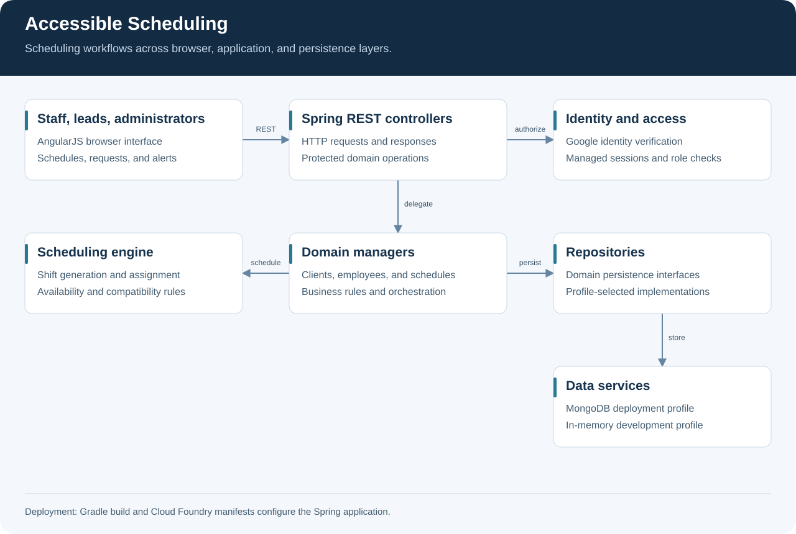

# Architecture

Scheduling workflows across browser, application, and persistence layers.

Deployment: Gradle build and Cloud Foundry manifests configure the Spring application.

## Implementation references

- [src/main/resources/static/js](../src/main/resources/static/js)
- [src/main/java/accessiblescheduling/controller](../src/main/java/accessiblescheduling/controller)
- [src/main/java/accessiblescheduling/manager](../src/main/java/accessiblescheduling/manager)
- [src/main/java/accessiblescheduling/config](../src/main/java/accessiblescheduling/config)
- [build.gradle](../build.gradle)

## Project overview

[Portfolio project page](https://johnbieniek.com/projects/accessible-scheduling)
